<p align="center">
  <picture>
    <source media="(max-width: 760px) and (prefers-color-scheme: dark)" srcset="https://raw.githubusercontent.com/MohaMedTArEk912/MohaMedTArEk912/main/assets/hero/builder-profile-v2-mobile-dark.svg">
    <source media="(max-width: 760px)" srcset="https://raw.githubusercontent.com/MohaMedTArEk912/MohaMedTArEk912/main/assets/hero/builder-profile-v2-mobile-light.svg">
    <source media="(prefers-color-scheme: dark)" srcset="https://raw.githubusercontent.com/MohaMedTArEk912/MohaMedTArEk912/main/assets/hero/builder-profile-v2-dark.svg">
    <source media="(prefers-color-scheme: light)" srcset="https://raw.githubusercontent.com/MohaMedTArEk912/MohaMedTArEk912/main/assets/hero/builder-profile-v2-light.svg">
    
  </picture>
</p>

<p align="center">
  <a href="https://mohamed-tarek-p.vercel.app/">
    
  </a>
  &nbsp;
  <a href="https://mail.google.com/mail/?view=cm&fs=1&to=mohaamedtariq12@gmail.com&su=Hello%20Mohamed%20%E2%80%94%20Portfolio%20Inquiry">
    
  </a>
  &nbsp;
  <a href="https://www.linkedin.com/in/mohamed-tarek-184510337/">
    
  </a>
  &nbsp;
  <a href="https://mohamed-tarek-p.vercel.app/mohamed-tarek-hussien-resume.pdf">
    
  </a>
</p>

## Hey, I'm Mohamed Tarek

I'm a **Full-Stack Software Engineer (MERN & DevOps)** based in Cairo, Egypt. I build MERN applications with MongoDB, Express.js, React, and Node.js, engineer real-time systems with Socket.IO, and automate containerized cloud infrastructure.

I hold a **B.Sc. in Computer Science and Information** (Software Engineering Department, 2022–2026) from **Helwan University**, and placed **3rd Nationwide for Best Project** in the **DEPI (Digital Egypt Pioneers Initiative) DevOps Engineer Track**.

---

## Interactive Portfolio — *The Architect Chronicles*

This repository powers both my GitHub profile and my interactive engineering portfolio, combining a lightweight editorial landing page, an 8-volume flipbook comic, a 3D WebGL spatial tour, 5 engineering arcade mini-games, an interactive terminal CLI, and a print-ready ATS résumé.

<p align="center">
  <a href="https://mohamed-tarek-p.vercel.app/">
    
  </a>
</p>

| Edition | Route | What's Inside |
| :--- | :--- | :--- |
| **Editorial Portfolio** | [`/`](https://mohamed-tarek-p.vercel.app/) | Fast-loading illustrated overview with interactive case study dialogs, timeline, skills, and downloadable PDF résumé. |
| **Interactive Comic Flipbook** | [`/comic/`](https://mohamed-tarek-p.vercel.app/comic/) | 8-volume page-turning archive (*Volumes I–VIII*) with keyboard navigation and command palette (`Ctrl+K`). |
| **3D Spatial Tour** | [`/comic/?view=stage`](https://mohamed-tarek-p.vercel.app/comic/?view=stage) | React Three Fiber + GSAP ScrollTrigger + Lenis camera trajectory with rigged MetaPerson 3D avatar, Kubernetes pods, and arcade mini-games. |
| **ATS Print Résumé** | [`/resume/`](https://mohamed-tarek-p.vercel.app/resume/) · [PDF](https://mohamed-tarek-p.vercel.app/mohamed-tarek-hussien-resume.pdf) | Clean black-and-white résumé with one-page A4 print layout and matching PDF download. |

---

## Featured Case Studies

| Project | Role & Status | What I Built | Links |
| :--- | :--- | :--- | :--- |
| **Akasha Platform** | Team Lead & Full-Stack Engineer · *Graduation Project* | AI-assisted workspace for turning software ideas into system architecture blueprints, database schemas, REST API specs, Git workflows, and real-time collaboration. | [Repository](https://github.com/MohaMedTArEk912/Akasha) |
| **DEPI Cloud Infrastructure** | DevOps Engineer · *3rd Place Nationwide* | Containerized AWS deployment pipeline using Docker, Kubernetes, Terraform, Ansible, Jenkins, GitHub Actions, Prometheus, and Grafana. | [Repository](https://github.com/Devopsians12/Devopsians) |
| **ICU Management System** | Backend & Integration Developer · *Completed* | Real-time intensive-care clinical operations backend built with Node.js, Express, MongoDB, REST APIs, and Socket.IO event broadcasts. | [Repository](https://github.com/Devopsians12/Devopsians) |
| **Competitive Quiz Platform** | Sole Full-Stack Developer · *Live Demo* | End-to-end multiplayer MERN quiz application with authentication, REST APIs, live Socket.IO rooms, and synchronized scoring. | [Repository](https://github.com/MohaMedTArEk912/FutureRobins) · [Live Demo](https://futurerobins.vercel.app/demo) |
| **Library Management System** | Team Lead & Frontend Developer · *Delivered* | Led a 5-member agile team, reviewed pull requests, and built reusable, responsive React and Tailwind CSS interfaces integrated with backend APIs. | [Repository](https://github.com/Faculty-Team-2026/IA-library-management-system) |

---

## Experience, Education & Certifications

### Experience & Leadership

- **Project Coordinator** — *Eyouth · Digilians* (`May 2026 – Present`)
  Coordinating training schedules and onboarding, tracking milestones, and resolving operational and technical issues with mentors.
- **Programming Instructor** — *3C School* (`Jun 2025 – May 2026`)
  Teaching programming and algorithms through hands-on lessons, debugging exercises, and guided student projects.
- **Technical Support Representative** — *Vodafone · Data & Fixed* (`Jul 2024 – Dec 2024`)
  Diagnosed broadband, DSL, and router issues and escalated infrastructure incidents to network engineers.
- **Technical Support Representative** — *Vodafone · Corporate* (`Sep 2023 – Jan 2024`)
  Resolved enterprise connectivity requests with account managers and technical teams within SLA targets.

### Education & Training

- **Helwan University** — B.Sc. in Computer Science & Information, Software Engineering Department (`2022 – 2026`)
- **Digital Egypt Pioneers Initiative (DEPI)** — DevOps Engineer Track (`Jun 2025 – Dec 2025`) · **3rd Place for Best Project**
- **Mahara-Tech (ITI)** — MERN-Stack Development (`Aug 2024 – Jan 2025`)
- **Mahara-Tech (ITI)** — Cyber Security & Ethical Hacking (`Aug 2023 – Nov 2023`)

---

## Tools & Technologies

### Languages & Core

<p>
  
  
  
  
  
  
  
  
</p>

### Frontend & Interactive Web

<p>
  
  
  
  
  
</p>

### Backend & Real-Time Systems

<p>
  
  
  
  
  
</p>

### DevOps, Cloud & Observability

<p>
  
  
  
  
  
  
  
  
  
</p>

### Databases

<p>
  
  
  
</p>

---

## GitHub Stats & Activity

<p align="center">
  <a href="https://github.com/MohaMedTArEk912">
    
  </a>
</p>

<details>
<summary><strong>Recent Public Activity</strong></summary>
<br>

<!-- AUTO:ACTIVITY:START -->
- Nov 24, 2026: pushed 1 commit to [MohaMedTArEk912/MohaMedTArEk912](https://github.com/MohaMedTArEk912/MohaMedTArEk912).
- Nov 25, 2026: pushed 1 commit to [MohaMedTArEk912/FutureRobins](https://github.com/MohaMedTArEk912/FutureRobins).
- Nov 24, 2026: created a branch in [MohaMedTArEk912/MohaMedTArEk912](https://github.com/MohaMedTArEk912/MohaMedTArEk912).
- Nov 24, 2026: pushed 1 commit to [MohaMedTArEk912/FutureRobins](https://github.com/MohaMedTArEk912/FutureRobins).
- Nov 24, 2026: merged pull request [#16](https://github.com/MohaMedTArEk912/MohaMedTArEk912/pull/16) in [MohaMedTArEk912/MohaMedTArEk912](https://github.com/MohaMedTArEk912/MohaMedTArEk912).
- Nov 24, 2026: opened pull request [#16](https://github.com/MohaMedTArEk912/MohaMedTArEk912/pull/16) in [MohaMedTArEk912/MohaMedTArEk912](https://github.com/MohaMedTArEk912/MohaMedTArEk912).
<!-- AUTO:ACTIVITY:END -->

</details>

---

## About This Repository (Portfolio Architecture & Development)

<details>
<summary><strong>Portfolio Tech Stack, Architecture, CI/CD &amp; Local Setup</strong></summary>
<br>

### Architecture

```text
index.html (SEO, Open Graph, JSON-LD, Base-Aware Boot Preloader)
   │
   ▼
src/main.tsx
   ├── default route ────────────► src/Portfolio.tsx
   │                                 Editorial landing page, case study dialogs, résumé
   │
   └── /comic/ ──────────────────► src/App.tsx
                                     ├── ComicBookFlipReader (8-volume illustrated spreads)
                                     └── lazy(src/ArchiveExtras.tsx)
                                           ├── CommandPalette (Ctrl+K) & Terminal CLI
                                           ├── 5 Engineering Arcade Mini-Games + Trophy Room
                                           ├── Executive 2D / Print ATS Résumé
                                           └── lazy(SceneContainer) ──► Three.js / R3F / GSAP / Lenis
```

### Workflows & Automation

- **Portfolio CI & GitHub Pages** ([`.github/workflows/portfolio-ci.yml`](.github/workflows/portfolio-ci.yml)): Runs Oxlint, TypeScript typechecking, subpath-safe Vite production build (`--base /MohaMedTArEk912/`), [`scripts/verify-pages-build.mjs`](scripts/verify-pages-build.mjs) asset/SEO verification, and deploys to GitHub Pages with a live smoke check.
- **Profile Activity Updater** ([`.github/workflows/update-readme.yml`](.github/workflows/update-readme.yml)): Keeps the Recent Public Activity block in sync via [`scripts/update-readme.mjs`](scripts/update-readme.mjs).
- **Contribution Snake** ([`.github/workflows/generate-snake.yml`](.github/workflows/generate-snake.yml)): Generates GitHub contribution snake animations.

### Local Development

```bash
git clone https://github.com/MohaMedTArEk912/MohaMedTArEk912.git
cd MohaMedTArEk912
npm ci
npm run dev
```

| Command | Description |
| :--- | :--- |
| `npm run dev` | Start Vite development server at `http://localhost:5173/` |
| `npm run lint` | Run Oxlint static analysis across the codebase |
| `npm run typecheck` | Run TypeScript project reference checks (`tsc -b`) |
| `npm run build` | Typecheck and build the production bundle into `dist/` |
| `npm run verify:pages -- --base /MohaMedTArEk912/` | Validate `dist/` assets, subpath links, and SEO tags |
| `npm run preview` | Preview the production build locally |

</details>

---

<p align="center">
  Engineering scalable web applications &amp; reliable cloud infrastructure.
</p>
